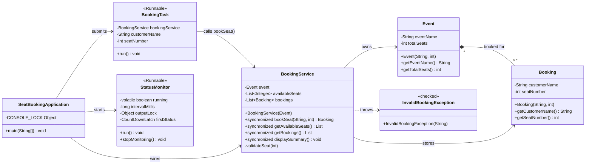
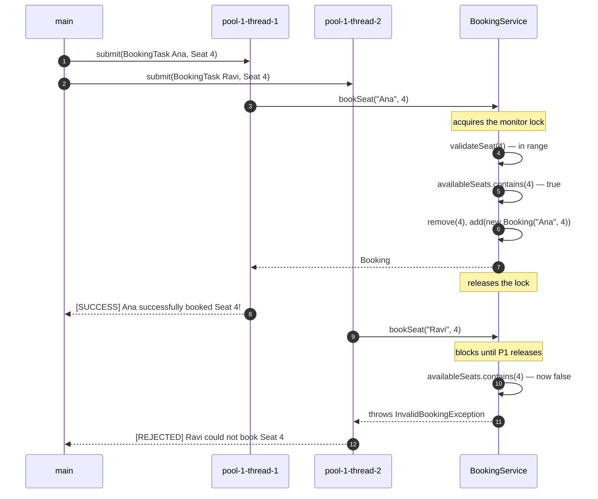
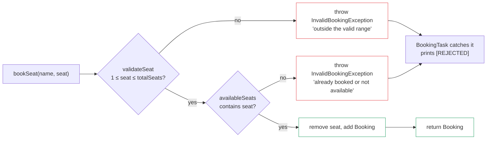

<div align="center">

# Concurrent Event Seat Booking System

<svg xmlns="http://www.w3.org/2000/svg" width="1.25em" height="1.25em" viewBox="0 0 24 24" fill="none" stroke="currentColor" stroke-width="2" stroke-linecap="round" stroke-linejoin="round" style="vertical-align:-0.2em"><path d="M2 9a3 3 0 0 1 0 6v2a2 2 0 0 0 2 2h16a2 2 0 0 0 2-2v-2a3 3 0 0 1 0-6V7a2 2 0 0 0-2-2H4a2 2 0 0 0-2 2Z"/><path d="M13 5v2"/><path d="M13 17v2"/><path d="M13 11v2"/></svg>

**A Java console application where several customers race for the same seat — and exactly one of them wins.**


</div>

---

## <svg xmlns="http://www.w3.org/2000/svg" width="1.1em" height="1.1em" viewBox="0 0 24 24" fill="none" stroke="currentColor" stroke-width="2" stroke-linecap="round" stroke-linejoin="round" style="vertical-align:-0.15em"><circle cx="12" cy="12" r="10"/><path d="M12 16v-4"/><path d="M12 8h.01"/></svg> Overview

One event. A finite number of seats. Many customers booking **at the same time**.

The whole point of this project is the race: when Ana and Ravi both ask for Seat 4 in the
same millisecond, one gets it and the other gets a clean rejection — never two people
sitting in the same chair, never a corrupted list, never a stack trace.

It is written in **plain Java 17** with **no frameworks, no build tool and no dependencies**,
because the interesting part is the concurrency, not the tooling. The concurrency primitives
are used directly and are visible in the source:

| Concern | Mechanism | Where |
|:--|:--|:--|
| Atomic check-then-reserve | `synchronized` method | `BookingService.bookSeat` |
| Safe stop flag across threads | `volatile` field | `StatusMonitor.running` |
| Concurrent execution | `ExecutorService` (fixed pool of 3) | `SeatBookingApplication.main` |
| Ordered startup | `CountDownLatch` handshake | `firstStatus` latch |
| Waiting for results | `Future.get()` | `SeatBookingApplication.waitForCompletion` |
| Graceful teardown | `shutdown()` + `awaitTermination()` | `SeatBookingApplication.main` |
| Rejected bookings | Custom **checked** exception | `InvalidBookingException` |
| Never corrupt the prompt | Dedicated console monitor lock | `CONSOLE_LOCK` |

<div align="center">

### <svg xmlns="http://www.w3.org/2000/svg" width="0.95em" height="0.95em" viewBox="0 0 24 24" fill="none" stroke="currentColor" stroke-width="2" stroke-linecap="round" stroke-linejoin="round" style="vertical-align:-0.15em"><path d="M20 13c0 5-3.5 7.5-7.66 8.95a1 1 0 0 1-.67-.01C7.5 20.5 4 18 4 13V6a1 1 0 0 1 1-1c2 0 4.5-1.2 6.24-2.72a1.17 1.17 0 0 1 1.52 0C14.51 3.81 17 5 19 5a1 1 0 0 1 1 1z"/><path d="m9 12 2 2 4-4"/></svg> Verified: 12,000 concurrent requests, **0** double bookings

</div>

---

## <svg xmlns="http://www.w3.org/2000/svg" width="1.1em" height="1.1em" viewBox="0 0 24 24" fill="none" stroke="currentColor" stroke-width="2" stroke-linecap="round" stroke-linejoin="round" style="vertical-align:-0.15em"><path d="M5 5a2 2 0 0 1 3.008-1.728l11.997 6.998a2 2 0 0 1 .003 3.458l-12 7A2 2 0 0 1 5 19z"/></svg> Quick Start

**Requirements:** JDK 17 or newer. Nothing else.

```bash
git clone https://github.com/RahulV17/Concurrent-TicketBooking.git
cd Concurrent-TicketBooking

# compile
javac -d bin src/*.java

# run
java -cp bin SeatBookingApplication
```

That is the entire setup. There is no `pom.xml`, no `build.gradle`, no `mvnw` — just
`javac` and `java`.

<details>
<summary><b>Run from IntelliJ IDEA</b></summary>

Open the project folder, right-click `src` → <b>Mark Directory as</b> → <b>Sources Root</b>,
then run `SeatBookingApplication.main()`. The module file already points at `src`.
</details>

<details>
<summary><b>What you will see</b></summary>

The app starts with a banner, then asks for an event name and seat count (both have
defaults — just press <kbd>Enter</kbd>), then drops into a five-option menu:

```text
--- MENU ---
1. Book a Single Seat
2. Submit Multiple Concurrent Bookings
3. View Available Seats
4. View Confirmed Bookings
5. Exit
```

To see the race for yourself, choose **Option 2**, ask for **2** concurrent requests,
and give both of them the **same seat number**. One gets `[SUCCESS]`, the other gets
`[REJECTED]`.
</details>

---

## <svg xmlns="http://www.w3.org/2000/svg" width="1.1em" height="1.1em" viewBox="0 0 24 24" fill="none" stroke="currentColor" stroke-width="2" stroke-linecap="round" stroke-linejoin="round" style="vertical-align:-0.15em"><path d="M12.83 2.18a2 2 0 0 0-1.66 0L2.6 6.08a1 1 0 0 0 0 1.83l8.58 3.91a2 2 0 0 0 1.66 0l8.58-3.9a1 1 0 0 0 0-1.83z"/><path d="M2 12a1 1 0 0 0 .58.91l8.6 3.91a2 2 0 0 0 1.65 0l8.58-3.9A1 1 0 0 0 22 12"/><path d="M2 17a1 1 0 0 0 .58.91l8.6 3.91a2 2 0 0 0 1.65 0l8.58-3.9A1 1 0 0 0 22 17"/></svg> Architecture

Seven classes, each with one job.



### <svg xmlns="http://www.w3.org/2000/svg" width="1em" height="1em" viewBox="0 0 24 24" fill="none" stroke="currentColor" stroke-width="2" stroke-linecap="round" stroke-linejoin="round" style="vertical-align:-0.15em"><path d="M6 22a2 2 0 0 1-2-2V4a2 2 0 0 1 2-2h8a2.4 2.4 0 0 1 1.704.706l3.588 3.588A2.4 2.4 0 0 1 20 8v12a2 2 0 0 1-2 2z"/><path d="M14 2v5a2 2 0 0 0 1 1h5"/><path d="M10 9H8"/><path d="M16 13H8"/><path d="M16 17H8"/></svg> Source layout

```text
Concurrent_Event_Seat_Booking_System/
├── src/
│   ├── Event.java                    immutable event: name + total seats
│   ├── Booking.java                  immutable record of one reservation
│   ├── InvalidBookingException.java  custom checked exception
│   ├── BookingService.java           owns the collections, owns the rules
│   ├── BookingTask.java              Runnable: one customer's request
│   ├── StatusMonitor.java            Runnable: background status line
│   └── SeatBookingApplication.java   main(): console + wiring
├── docs/
│   ├── sample-run-guide-scenario.txt captured transcript — guide's scenario
│   ├── sample-run-prd-scenario.txt   captured transcript — PRD's scenario
│   └── sample-run-edge-cases.txt     captured transcript — error paths
└── README.md
```

**521 lines across 7 files.** No `package` declaration — every class is in the default
package, which keeps the one-line compile command above working.

---

## <svg xmlns="http://www.w3.org/2000/svg" width="1.1em" height="1.1em" viewBox="0 0 24 24" fill="none" stroke="currentColor" stroke-width="2" stroke-linecap="round" stroke-linejoin="round" style="vertical-align:-0.15em"><path d="M12 20v2"/><path d="M12 2v2"/><path d="M17 20v2"/><path d="M17 2v2"/><path d="M2 12h2"/><path d="M2 17h2"/><path d="M2 7h2"/><path d="M20 12h2"/><path d="M20 17h2"/><path d="M20 7h2"/><path d="M7 20v2"/><path d="M7 2v2"/><rect x="4" y="4" width="16" height="16" rx="2"/><rect x="8" y="8" width="8" height="8" rx="1"/></svg> The Concurrency Model

### <svg xmlns="http://www.w3.org/2000/svg" width="1em" height="1em" viewBox="0 0 24 24" fill="none" stroke="currentColor" stroke-width="2" stroke-linecap="round" stroke-linejoin="round" style="vertical-align:-0.15em"><path d="M22 12h-2.48a1 1 0 0 0-1.93 1.46l-2.35 8.36a.25.25 0 0 1-.48 0L9.24 2.18a.25.25 0 0 0-.48 0l-2.35 8.36A1 1 0 0 1 4.49 12H2"/></svg> Threads at runtime

| Thread | Created by | Job | Ends when |
|:--|:--|:--|:--|
| `main` | JVM | Console loop, submits tasks, graceful shutdown | Option 5 is chosen, or input closes |
| `status-monitor` | `new Thread(monitor, "status-monitor")` | Prints readiness, then idles on a 5 s tick | `stopMonitoring()` flips `running` to `false` |
| `pool-1-thread-1` | `newFixedThreadPool(3)` | Runs `BookingTask`s | `executor.shutdown()` |
| `pool-1-thread-2` | `newFixedThreadPool(3)` | Runs `BookingTask`s | `executor.shutdown()` |
| `pool-1-thread-3` | `newFixedThreadPool(3)` | Runs `BookingTask`s | `executor.shutdown()` |

Five threads. The three pool workers are interchangeable — which one picks up which request
is intentionally nondeterministic.

### <svg xmlns="http://www.w3.org/2000/svg" width="1em" height="1em" viewBox="0 0 24 24" fill="none" stroke="currentColor" stroke-width="2" stroke-linecap="round" stroke-linejoin="round" style="vertical-align:-0.15em"><path d="M15 6a9 9 0 0 0-9 9V3"/><circle cx="18" cy="6" r="3"/><circle cx="6" cy="18" r="3"/></svg> How the race is resolved

Two customers, one seat. Here is exactly what happens:



The critical detail is **line 3 of `bookSeat`**: the `contains` check, the `remove` and the
`add` all happen *inside* one `synchronized` method body. The check and the reserve are a
single indivisible step. Split them across a lock boundary and both threads can see Seat 4
as free before either reserves it.

```java
public synchronized Booking bookSeat(String customerName, int seatNumber)
        throws InvalidBookingException {
    validateSeat(seatNumber);

    if (!availableSeats.contains(seatNumber)) {          // check
        throw new InvalidBookingException(
                "Seat " + seatNumber + " is already booked or not available.");
    }

    availableSeats.remove(Integer.valueOf(seatNumber)); // reserve — same lock
    Booking booking = new Booking(customerName, seatNumber);
    bookings.add(booking);
    return booking;
}
```

### <svg xmlns="http://www.w3.org/2000/svg" width="1em" height="1em" viewBox="0 0 24 24" fill="none" stroke="currentColor" stroke-width="2" stroke-linecap="round" stroke-linejoin="round" style="vertical-align:-0.15em"><rect width="18" height="11" x="3" y="11" rx="2" ry="2"/><path d="M7 11V7a5 5 0 0 1 10 0v4"/></svg> Every lock in the program

There are exactly **two** locks, and they never nest in a way that can deadlock.

| Lock | Object | Acquired by | Held for |
|:--|:--|:--|:--|
| Booking monitor | the `BookingService` instance | `bookSeat`, `getAvailableSeats`, `getBookings`, `displaySummary` | One method call |
| Console monitor | `static final Object CONSOLE_LOCK` | `main` and `StatusMonitor` | A whole menu turn, or one printed line |

**The deadlock that was avoided.** During teardown, `main` must stop the monitor and wait
for it to finish. If `main` held `CONSOLE_LOCK` while calling `monitorThread.join()`, the
monitor would be blocked forever waiting for the very lock `main` is holding while it
waits for the monitor — a classic deadlock. So the lock is **released** before the join:

```java
// join WITHOUT the lock — the monitor needs it to print its final line
monitor.stopMonitoring();
try {
    monitorThread.join();
} catch (InterruptedException e) {
    Thread.currentThread().interrupt();
}
```

### <svg xmlns="http://www.w3.org/2000/svg" width="1em" height="1em" viewBox="0 0 24 24" fill="none" stroke="currentColor" stroke-width="2" stroke-linecap="round" stroke-linejoin="round" style="vertical-align:-0.15em"><rect width="20" height="14" x="2" y="3" rx="2"/><path d="M12 17v4"/><path d="M8 21h8"/><path d="M12 13V7"/><path d="m15 10-3 3-3-3"/></svg> Keeping the console clean

A background thread printing to `System.out` while a human is halfway through typing a
customer name would corrupt the prompt. Three things prevent that:

1. **`main` holds `CONSOLE_LOCK` for an entire menu turn** — menu, prompt, action and the
   action's output are one atomic block.
2. **The monitor must acquire the same lock before printing**, and re-checks its `volatile`
   `running` flag *after* taking the lock, so it never publishes a stale line on its way out.
3. **A `CountDownLatch` handshake** guarantees the readiness line appears *before* the menu
   rather than in the middle of it.

This is also why the monitor prints **once** at startup rather than every 5 seconds: with
the console held for whole menu turns, a periodic tick can only land when the console is
free. Leaving the app idle at the menu for 14 seconds produces one status line, not three.

---

## <svg xmlns="http://www.w3.org/2000/svg" width="1.1em" height="1.1em" viewBox="0 0 24 24" fill="none" stroke="currentColor" stroke-width="2" stroke-linecap="round" stroke-linejoin="round" style="vertical-align:-0.15em"><path d="M3 12a9 9 0 0 1 9-9 9.75 9.75 0 0 1 6.74 2.74L21 8"/><path d="M21 3v5h-5"/><path d="M21 12a9 9 0 0 1-9 9 9.75 9.75 0 0 1-6.74-2.74L3 16"/><path d="M8 16H3v5"/></svg> Sample Run

Two customers want Seat 4. One wins. Here is real captured output:

```text
=================================================================
        CONCURRENT EVENT SEAT BOOKING SYSTEM (INTERACTIVE)
=================================================================

Enter Event Name: Tech Meetup 2026
Enter Total Number of Seats: 10
[OK] Created Event 'Tech Meetup 2026' with 10 seats (Seats 1 to 10).
[status-monitor] [STATUS-MONITOR] Status: ACTIVE. Booking service is running and ready.
--- MENU ---
1. Book a Single Seat
2. Submit Multiple Concurrent Bookings
3. View Available Seats
4. View Confirmed Bookings
5. Exit
Select an option (1-5): How many concurrent booking requests? 3
  Request 1 - Customer Name: Ana
  Request 1 - Seat Number: 4
  Request 2 - Customer Name: Ravi
  Request 2 - Seat Number: 4
  Request 3 - Customer Name: Meera
  Request 3 - Seat Number: 5
[APPLICATION] Launching 3 requests SIMULTANEOUSLY across thread pool...
[pool-1-thread-3] [SUCCESS] Ravi successfully booked Seat 4!
[pool-1-thread-3] [DONE] Booking attempt for Ravi (Seat 4) completed.
[pool-1-thread-1] [SUCCESS] Meera successfully booked Seat 5!
[pool-1-thread-1] [DONE] Booking attempt for Meera (Seat 5) completed.
[pool-1-thread-2] [REJECTED] Ana could not book Seat 4: Seat 4 is already booked or not available.
[pool-1-thread-2] [DONE] Booking attempt for Ana (Seat 4) completed.
--- MENU ---
1. Book a Single Seat
2. Submit Multiple Concurrent Bookings
3. View Available Seats
4. View Confirmed Bookings
5. Exit
Select an option (1-5): [AVAILABLE SEATS]: [1, 2, 3, 6, 7, 8, 9, 10]
--- MENU ---
1. Book a Single Seat
2. Submit Multiple Concurrent Bookings
3. View Available Seats
4. View Confirmed Bookings
5. Exit
Select an option (1-5): [CONFIRMED BOOKINGS]:
  - Booking[Customer: Ravi, Seat: 4]
  - Booking[Customer: Meera, Seat: 5]
--- MENU ---
1. Book a Single Seat
2. Submit Multiple Concurrent Bookings
3. View Available Seats
4. View Confirmed Bookings
5. Exit
Select an option (1-5): [APPLICATION] Shutting down thread pool executor...
[APPLICATION] Stopping background status monitor...
[status-monitor] [MONITOR STOP] Status monitor stopped cleanly.
==================== BOOKING SUMMARY ====================
Event: Tech Meetup 2026 | Total: 10 | Booked: 2 | Remaining: 8
=========================================================
```

> **Which customer wins is nondeterministic.** Ana won Seat 4 in the original guide
> transcript; on a re-run Ravi wins instead. The *outcome* is always identical — one
> success, one rejection, `booked + available == total` — but the thread names and line
> order move around. That is the point of the exercise.

Full transcripts live in `docs/`:

| File | Demonstrates |
|:--|:--|
| `docs/sample-run-guide-scenario.txt` | The guide's sample scenario, reproduced exactly |
| `docs/sample-run-prd-scenario.txt` | A 4-request batch with an out-of-range seat and a contested seat |
| `docs/sample-run-edge-cases.txt` | Empty name, seat 0, seat above capacity, zero-sized batch |

---

## <svg xmlns="http://www.w3.org/2000/svg" width="1.1em" height="1.1em" viewBox="0 0 24 24" fill="none" stroke="currentColor" stroke-width="2" stroke-linecap="round" stroke-linejoin="round" style="vertical-align:-0.15em"><circle cx="12" cy="12" r="10"/><line x1="12" x2="12" y1="8" y2="12"/><line x1="12" x2="12.01" y1="16" y2="16"/></svg> Validation &amp; Error Handling

`InvalidBookingException` is a **checked** exception on purpose. A rejected booking is not
an edge case to be swept away — the caller is forced to decide what to do with it.



### <svg xmlns="http://www.w3.org/2000/svg" width="1em" height="1em" viewBox="0 0 24 24" fill="none" stroke="currentColor" stroke-width="2" stroke-linecap="round" stroke-linejoin="round" style="vertical-align:-0.15em"><path d="M13 5h8"/><path d="M13 12h8"/><path d="M13 19h8"/><path d="m3 17 2 2 4-4"/><path d="m3 7 2 2 4-4"/></svg> Every rejection message

| Trigger | Message | Source |
|:--|:--|:--|
| Seat number outside `1..totalSeats` | `Seat 7 is outside the valid range 1 to 10.` | `BookingService.validateSeat` |
| Seat already taken | `Seat 4 is already booked or not available.` | `BookingService.bookSeat` |

### <svg xmlns="http://www.w3.org/2000/svg" width="1em" height="1em" viewBox="0 0 24 24" fill="none" stroke="currentColor" stroke-width="2" stroke-linecap="round" stroke-linejoin="round" style="vertical-align:-0.15em"><path d="M12 22a2 2 0 0 1-2-2V4a2 2 0 0 1 2-2h8a2.4 2.4 0 0 1 1.704.706l3.588 3.588A2.4 2.4 0 0 1 20 8v12a2 2 0 0 1-2 2z"/><path d="M14 2v5a2 2 0 0 0 1 1h5"/><path d="M10 12.5 8 15l2 2.5"/><path d="m14 12.5 2 2.5-2 2.5"/></svg> Every input the console handles

| Input | Behaviour |
|:--|:--|
| Empty customer name | Re-prompts: `[ERROR] This field cannot be empty.` |
| Empty event name / seat count | Accepts the defaults `Tech Meetup 2026` / `10` |
| Seat `0`, or above capacity | `[REJECTED] … is outside the valid range 1 to N.` |
| Same seat twice in one batch | Exactly one wins; the other is `[REJECTED]` |
| Option 4 with no bookings | Prints `(no bookings yet)` |
| Non-numeric or out-of-`int` seat (`999999999999`) | Re-prompts: `[ERROR] Please enter a whole number (maximum 2147483647).` |
| Batch count `0` or negative | Re-prompts: `[ERROR] Value must be greater than 0.` |
| Menu choice outside 1–5 | Re-prompts: `[ERROR] Invalid option. Please enter a number between 1 and 5.` |
| Input stream closed (EOF) | Exits cleanly with code `0` — no stack trace |

---

## <svg xmlns="http://www.w3.org/2000/svg" width="1.1em" height="1.1em" viewBox="0 0 24 24" fill="none" stroke="currentColor" stroke-width="2" stroke-linecap="round" stroke-linejoin="round" style="vertical-align:-0.15em"><path d="M15 14c.2-1 .7-1.7 1.5-2.5 1-.9 1.5-2.2 1.5-3.5A6 6 0 0 0 6 8c0 1 .2 2.2 1.5 3.5.7.7 1.3 1.5 1.5 2.5"/><path d="M9 18h6"/><path d="M10 22h4"/></svg> Design Decisions

The judgement calls, and why they went the way they did.

| Decision | Reasoning |
|:--|:--|
| **Interactive menu instead of a hardcoded demo** | You cannot see a race condition unless you can fire two conflicting requests yourself. The transcript above is four keystrokes apart. |
| **Checked `InvalidBookingException`** | Forces every caller to handle a rejection explicitly. An unchecked exception would let a booking silently vanish. |
| **`synchronized` on the method, not on a block** | The whole method is one critical section. Method-level locking makes that impossible to break by accident later. |
| **Defensive copies from the getters** | `getAvailableSeats()` returns `new ArrayList<>(availableSeats)`. Callers can never mutate the service's internal state. |
| **Rejection message kept verbatim** | `Seat 4 is already booked or not available.` is longer than the natural phrasing, but it is what the reference sample used, so it is used unchanged. |
| **Monitor interval of 5 s** | Per the reference thread table. The pseudocode elsewhere suggested 1 s; `MONITOR_INTERVAL_MILLIS` changes it. |
| **Defaults: `Tech Meetup 2026`, 10 seats** | Neither was specified, so both are taken from the reference sample run. |
| **`CONSOLE_LOCK` and `firstStatus` are additions** | Neither is in the original brief. The first stops the monitor from splitting a line you are typing; the second guarantees the readiness line lands before the menu. |
| **No `BookingBatchTask` class** | The brief permits submitting multiple `BookingTask`s directly. That is what the code does — less code, same behaviour. |
| **No package declaration** | Keeps `javac -d bin src/*.java` and `java -cp bin SeatBookingApplication` working as one-liners. |

### <svg xmlns="http://www.w3.org/2000/svg" width="1em" height="1em" viewBox="0 0 24 24" fill="none" stroke="currentColor" stroke-width="2" stroke-linecap="round" stroke-linejoin="round" style="vertical-align:-0.15em"><path d="M12 20v-9"/><path d="M14 7a4 4 0 0 1 4 4v3a6 6 0 0 1-12 0v-3a4 4 0 0 1 4-4z"/><path d="M14.12 3.88 16 2"/><path d="M21 21a4 4 0 0 0-3.81-4"/><path d="M21 5a4 4 0 0 1-3.55 3.97"/><path d="M22 13h-4"/><path d="M3 21a4 4 0 0 1 3.81-4"/><path d="M3 5a4 4 0 0 0 3.55 3.97"/><path d="M6 13H2"/><path d="m8 2 1.88 1.88"/><path d="M9 7.13V6a3 3 0 1 1 6 0v1.13"/></svg> Honest limitations

This is a learning project, and it is worth being precise about what it is not:

- **There is no test suite in the repository.** The concurrency claim was verified with a
  throwaway harness — 200 rounds × 60 concurrent requests against a 10-seat event,
  **12,000 requests, 0 double bookings**, with `booked + available == total` holding in
  every round. The same harness with `synchronized` removed from `bookSeat` produced
  duplicate bookings within the first round. That harness is not committed.
- **`synchronized` on every public method is coarse.** A per-seat lock or a
  `ConcurrentHashMap` would scale better under heavy contention. The coarse lock is
  correct and obvious, which is the right trade for a teaching project.
- **The pool is fixed at 3 threads.** Sized to make contention visible, not to maximise
  throughput.
- **The monitor's periodic tick rarely fires in an interactive session**, because the
  console lock is held for whole menu turns. The loop is present and correct; it just
  rarely gets a turn.
- **There is no CI, no coverage report, and no published release.** There is no
  `LICENSE` file either — the repository is unlicensed, so the license badge is
  deliberately absent rather than pointing at a license that does not exist.

---

## <svg xmlns="http://www.w3.org/2000/svg" width="1.1em" height="1.1em" viewBox="0 0 24 24" fill="none" stroke="currentColor" stroke-width="2" stroke-linecap="round" stroke-linejoin="round" style="vertical-align:-0.15em"><rect width="8" height="8" x="3" y="3" rx="2"/><path d="M7 11v4a2 2 0 0 0 2 2h4"/><rect width="8" height="8" x="13" y="13" rx="2"/></svg> Tech Stack

<div align="center">

<a href="https://github.com/RahulV17/Concurrent-TicketBooking">

</a>
&nbsp;&nbsp;
<a href="https://openjdk.org/">

</a>
&nbsp;&nbsp;
<a href="https://www.jetbrains.com/idea/">

</a>
&nbsp;&nbsp;
<a href="https://github.com/RahulV17/Concurrent-TicketBooking">

</a>

</div>

| Layer | Choice | Notes |
|:--|:--|:--|
| Language | Java 17 (LTS) | `switch` expressions, `var`-free for clarity |
| Build | `javac` directly | No Maven, no Gradle, no wrapper |
| UI | `java.util.Scanner` | Interactive console, five menu options |
| Collections | `ArrayList` | `List<Integer>` for free seats, `List<Booking>` for records |
| Concurrency | `ExecutorService`, `synchronized`, `volatile`, `CountDownLatch`, `Future` | Standard library only |
| Exceptions | Custom checked exception | `InvalidBookingException extends Exception` |
| IDE | IntelliJ IDEA | `src` is the source root, `bin` is the output folder |
| Dependencies | **None** | Nothing to install, nothing to resolve |

---

## <svg xmlns="http://www.w3.org/2000/svg" width="1.1em" height="1.1em" viewBox="0 0 24 24" fill="none" stroke="currentColor" stroke-width="2" stroke-linecap="round" stroke-linejoin="round" style="vertical-align:-0.15em"><path d="M12 5v16"/><path d="M20.001 19A2 2 0 0022 17V5a2 2 0 0 0-1.999-2L16 3.002A5 5 0 0012 5a5 5 0 0 0-4-2H4a2 2 0 0 0-2 2v12a2 2 0 0 0 1.999 2H8a5 5 0 0 1 4 2 5 5 0 0 1 4-2z"/></svg> Documentation

| Document | What it covers |
|:--|:--|
| [`docs/interview-questions.md`](docs/interview-questions.md) | 60+ viva and interview questions with `file:line` pointers into the source — OOP principles, collections, exception handling, and every concurrency primitive used here |
| `docs/sample-run-guide-scenario.txt` | A captured run of the reference scenario |
| `docs/sample-run-prd-scenario.txt` | A captured run with four concurrent requests, including an out-of-range seat |
| `docs/sample-run-edge-cases.txt` | A captured run through every error path |

> **Note:** `docs/interview-questions.md` is listed in `.gitignore` as study material, so it
> is not part of the committed repository. It is included here as a pointer to what the
> project covers.

---

## <svg xmlns="http://www.w3.org/2000/svg" width="1.1em" height="1.1em" viewBox="0 0 24 24" fill="none" stroke="currentColor" stroke-width="2" stroke-linecap="round" stroke-linejoin="round" style="vertical-align:-0.15em"><path d="M16 21v-2a4 4 0 0 0-4-4H6a4 4 0 0 0-4 4v2"/><path d="M16 3.128a4 4 0 0 1 0 7.744"/><path d="M22 21v-2a4 4 0 0 0-3-3.87"/><circle cx="9" cy="7" r="4"/></svg> Contributing

Contributions are welcome. The project is small enough to read in ten minutes, so a good
change is one that makes the concurrency argument clearer, not one that adds more surface
area.

**Good contributions**

- A JUnit test suite for `BookingService`, especially the contention case
- Replacing the coarse `synchronized` with per-seat locking, with a benchmark to compare
- Making the `docs/interview-questions.md` set tracked rather than ignored
- Additional captured transcripts in `docs/`

**Before opening a pull request**

```bash
javac -d bin src/*.java               # must compile clean, no warnings
java -cp bin SeatBookingApplication   # must start, menu must render
```

Keep the style consistent: 4-space indent, no `package` declaration, `final` on fields
that never change, and a comment only where the *reasoning* is not obvious from the code.

---

## <svg xmlns="http://www.w3.org/2000/svg" width="1.1em" height="1.1em" viewBox="0 0 24 24" fill="none" stroke="currentColor" stroke-width="2" stroke-linecap="round" stroke-linejoin="round" style="vertical-align:-0.15em"><path d="M8.75.75V2h.985c.304 0 .603.08.867.231l1.29.736c.038.022.08.033.124.033h2.234a.75.75 0 0 1 0 1.5h-.427l2.111 4.692a.75.75 0 0 1-.154.838l-.53-.53.529.531-.001.002-.002.002-.006.006-.006.005-.01.01-.045.04c-.21.176-.441.327-.686.45C14.556 10.78 13.88 11 13 11a4.498 4.498 0 0 1-2.023-.454 3.544 3.544 0 0 1-.686-.45l-.045-.04-.016-.015-.006-.006-.004-.004v-.001a.75.75 0 0 1-.154-.838L12.178 4.5h-.162c-.305 0-.604-.079-.868-.231l-1.29-.736a.245.245 0 0 0-.124-.033H8.75V13h2.5a.75.75 0 0 1 0 1.5h-6.5a.75.75 0 0 1 0-1.5h2.5V3.5h-.984a.245.245 0 0 0-.124.033l-1.289.737c-.265.15-.564.23-.869.23h-.162l2.112 4.692a.75.75 0 0 1-.154.838l-.53-.53.529.531.001.002.002.002.006.006.006.005.01.01.045.04c.21.176.441.327.686.45C4.556 10.78 3.88 11 3 11a4.498 4.498 0 0 1-2.023-.454 3.544 3.544 0 0 1-.686-.45l-.045-.04-.016-.015-.006-.006-.004-.004v-.001a.75.75 0 0 1-.154-.838L2.178 4.5H1.75a.75.75 0 0 1 0-1.5h2.234a.249.249 0 0 0 .125-.033l1.288-.737c.265-.15.564-.23.869-.23h.984V.75a.75.75 0 0 1 1.5 0Zm2.945 8.477c.285.135.718.273 1.305.273s1.02-.138 1.305-.273L13 6.327Zm-10 0c.285.135.718.273 1.305.273s1.02-.138 1.305-.273L3 6.327Z"/></svg> License

This repository has **no license file**, so it is not currently licensed for reuse. If you
want to use, modify or redistribute this code, open an issue and ask for the license to be
clarified — or add a `LICENSE` file and open a pull request.

The icons in this README are [Lucide](https://lucide.dev) (ISC License) and
[Simple Icons](https://simpleicons.org) (CC0-1.0).

---

<div align="center">

**Built as a hands-on study of Java concurrency — `synchronized`, `volatile`, `ExecutorService` and `CountDownLatch`, with no framework in the way.**

</div>
